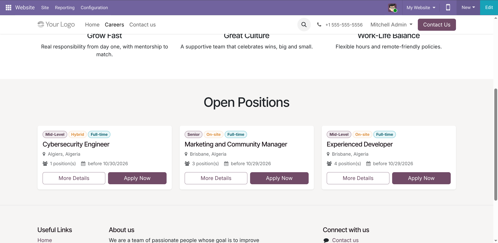
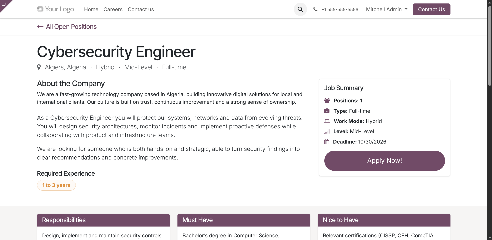
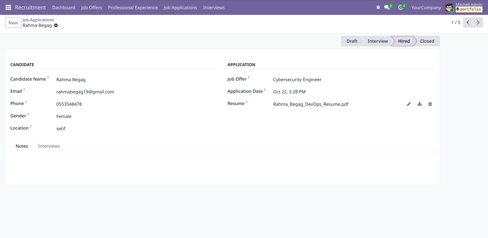
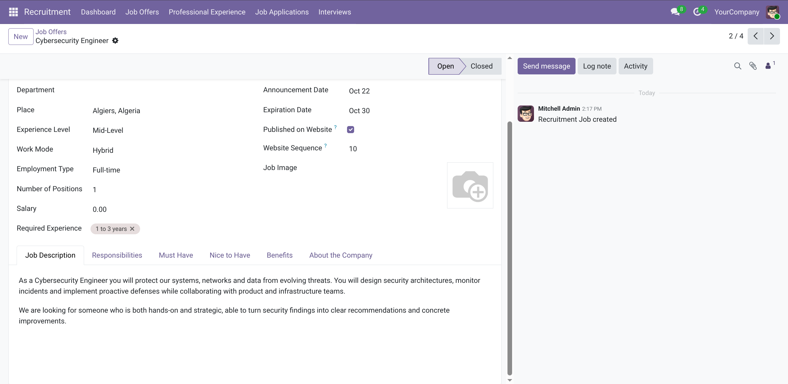
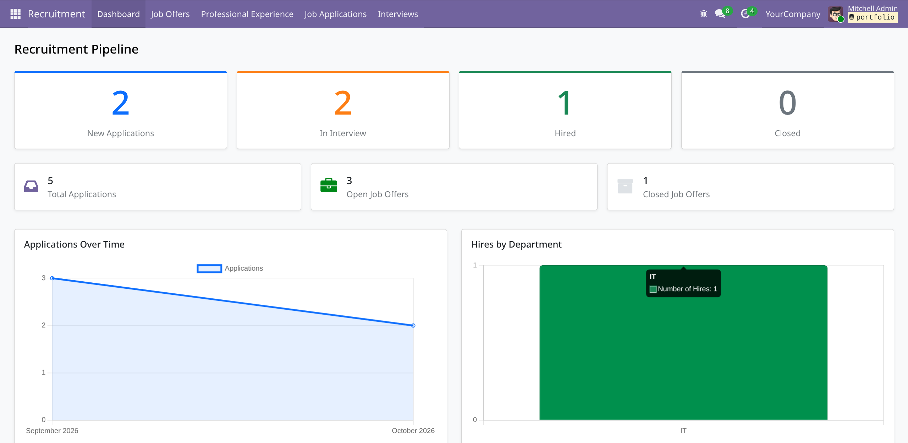
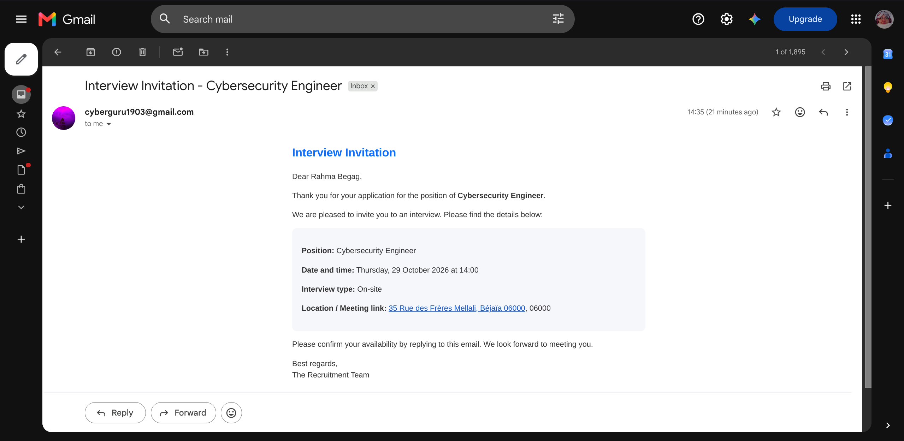
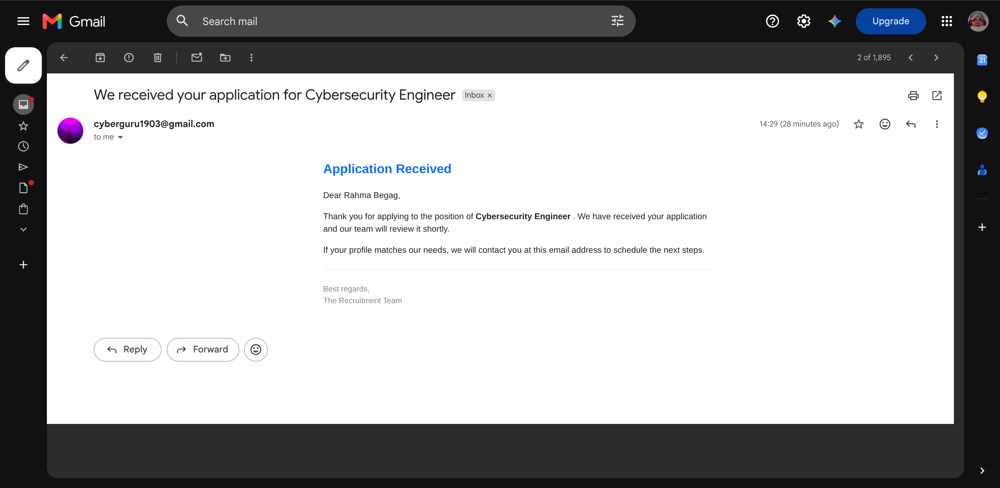

# Recruitment Management

**Custom Odoo 19 module** to manage job openings, candidate applications, and interview scheduling — with a public careers website where candidates can apply without creating an account.


---

## Features

### Backend (Odoo)
- **Job Offers** – Create and manage job postings (title, place, level, work mode, employment type, salary…)
- **Applications** – Track candidates with resume upload, status pipeline (Draft → Interview → Hired / Closed)
- **Interviews** – Schedule interviews (phone / online / on-site), assign interviewer, record feedback and result
- **Dashboard** – Visual statistics (applications over time, pipeline stages, hires by department)
- **Chatter & Activities** – Full messaging and activity tracking on jobs, applications and interviews

### Public Website
- Beautiful **Careers page** (`/careers`) listing all open positions
- Detailed **Job page** with modern layout (summary sidebar, responsibilities, must-have, nice-to-have, benefits…)
- Online application form (modal) with CV upload (PDF/DOC/DOCX, max 5 MB)

### Automated Emails
- **Application confirmation** – Candidate receives an email as soon as they apply
- **Interview invitation** – Candidate automatically receives an email with date, time, type and location/link when an interview is created

---

## Screenshots

### Careers list page


### Job detail page


### Application form (modal)


### Backend – Job form


### Dashboard


### Received Mails



---

## Installation

1. Clone or download this repository into your Odoo `addons` path:

```bash
git clone https://github.com/Rahma-Begag-19/odoo-recruitment-management.git